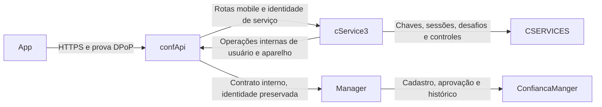

> Registro histórico de uma etapa anterior. A estrutura atual usa cinco tabelas novas no Manager e reutiliza usuario/dispositivo. Não aplicar as instruções antigas de banco deste documento. Consulte [a redução atual](REDUCAO_TABELAS_MANAGER_20261106.md) e o script manual 011_manager_auth_reduzido.sql.

> HISTÓRICO: substituído pela [arquitetura atual](ARQUITETURA_TOKENS_E_AUTENTICACAO.md). Não executar as instruções de migração do antigo cService. O cService atual não usa banco.

# Adequação ao plano original e ao cadastro dispositivo — 05/11/2026

Referência: Plano_Autenticador_Mobile_v2_20261105.txt, principalmente seções 3, 4, 7, 8 e 10. O cService3 continua responsável por chaves, sessões, códigos e desafios. A orientação adicional do usuário coloca o confApi como entrada do app e intermediário das operações de cadastro no Manager. O documento é referência de requisitos; seu bloco de instruções para outros chats não autoriza alterações de produção.

## Fluxo implementado

Os dois sentidos entre confApi e cService3 usam contratos distintos: o confApi encaminha /api/v2/autenticador-mobile ao autenticador; o cService3 solicita /internal/v2/autenticacao, /internal/v2/dispositivos e o perfil ao confApi, que chama o Manager. Não existe encaminhamento genérico de URLs nem SQL por HTTP. O cService3 não conecta ao banco ConfiancaManger nem grava dispositivo.

O confApi possui uma cadeia de segurança própria para as 13 operações mobile permitidas. Não encaminha Host, Forwarded ou credenciais internas fornecidas pelo app. Acrescenta sua própria identidade em X-Auth-Gateway. O cService3 exige sub=confapi (configurável), audiência cservice3-internal e escopo mobile:relay, além da autenticação/prova do usuário quando exigida. Uma credencial de serviço não libera operações de negócio.

A prova DPoP usa a URL pública do confApi, incluindo o contexto WAR, mesmo quando verificada no cService3. AUTH_MOBILE_PUBLIC_BASE_URL é configurada no servidor; nenhum cabeçalho do cliente escolhe a URL de verificação. O confApi calcula X-Auth-Client-Key a partir do endereço de transporte, para evitar agregar todos os logins sob o IP do relay. Cabeçalhos externos não escolhem essa chave; atrás de proxies, configurar a infraestrutura e seus limites sem confiar em Forwarded arbitrário.

## Onde os dispositivos são gravados

Antes desta correção, o fluxo v2 atualizava AUTH_V2_ACCOUNT e não gravava o vínculo aprovado na tabela dispositivo. O campo deviceId também continha o ID da solicitação. Agora:

1. A autenticação primária identifica o usuário canônico no Manager. Um registro legado não é importado como aprovado.
2. A solicitação é gravada em AUTH_V2_ENROLLMENT, no Manager, vinculada ao usuário, candidato, impressão digital, versão esperada e FK do dispositivo anterior. Modelo e marca declarados ficam nessa pendência; não são prova de identidade.
3. Solicitar ou aprovar não sobrescreve dispositivo. A ativação ainda exige prova fresca da chave no cService3 e aprovação específica no Manager.
4. Na ativação, o Manager bloqueia a conta, confere a versão e reutiliza a linha de dispositivo do login. Se não existe vínculo anterior, cria a primeira linha. Não cria uma segunda linha para representar a troca do mesmo usuário.
5. O mesmo compromisso JDBC atualiza dispositivo, a política/versão em AUTH_V2_ACCOUNT, o estado da solicitação e AUTH_V2_HISTORY. Falha na auditoria desfaz todo esse compromisso. Repetir a ativação não duplica dispositivo ou histórico.
6. O deviceId devolvido é o codg_dispositivo convertido para texto. A versão distingue as trocas que reutilizam a mesma linha. O campo legacy_device_id de AUTH_V2_ACCOUNT conserva seu nome para compatibilidade, mas referencia o registro canônico usado pela autorização.

codigo_dispositivo recebe o identificador opaco do candidato criado pelo cService3; não é serial físico nem prova suficiente de autorização. Modelo/marca passam da pendência para dispositivo somente na ativação. Se não foram informados, não se mantém a descrição do aparelho anterior. O push anterior é apagado; PUT /dispositivo/push só atualiza o aparelho/versão atuais e grava token_expo em dispositivo. O token físico legado é desabilitado nessa troca, sem reabrir validadores antigos.

A autorização e o JWT individual conferem também a existência e a titularidade do registro de dispositivo. Divergência ou exclusão não restaura a elegibilidade de primeiro cadastro: a política mínima permanece no Manager.

## Dono dos dados

| Estrutura | Banco e finalidade |
|---|---|
| dispositivo | ConfiancaManger: vínculo canônico usuário/aparelho |
| AUTH_V2_ACCOUNT | ConfiancaManger: política mínima, versão, chave aprovada e referência ao dispositivo |
| AUTH_V2_ENROLLMENT | ConfiancaManger: solicitação, aprovação e candidato; não substitui o atual antes da ativação |
| AUTH_V2_HISTORY | ConfiancaManger: alterações de aparelho, operador/serviço, instante, versão e snapshots anteriores/novos sem tokens |
| AUTH_V2_CONTACT | ConfiancaManger: contato verificado e evidência independente |
| AUTH_V2_PRIMARY | ConfiancaManger: referência temporária da autenticação primária do portal |
| AUTH_V2_OUTBOX | ConfiancaManger: notificação durável de pendência à TI, com deduplicação/retry |
| AUTH_V2_LIMIT | ConfiancaManger: limites das operações sob sua autoridade |
| Oito AUTH_MOBILE_* | CSERVICES: armazenamento técnico do autenticador previsto no plano; ATIVO permanece como bloqueio/ponteiro local, subordinado ao Manager |

AUTH_V2_CONTACT, PRIMARY, OUTBOX e HISTORY já estavam configuradas no datasource do Manager; não foram transferidas do CSERVICES. A nova correção não cria tabelas adicionais. AUTH_MOBILE_CADASTRO é o contexto técnico que referencia a solicitação do Manager, não uma segunda autoridade de aprovação. AUTH_MOBILE_EVENTO registra decisões do autenticador, não substitui o histórico de alterações de dispositivo.

### Quando AUTH_V2_CONTACT é usada

No primeiro vínculo ou na recuperação, o backend precisa saber para qual contato confiável pode enviar a confirmação. Ter um e-mail em usuario, ou recebê-lo do aparelho candidato, não prova que ele foi verificado. Se não há evidência, o suporte confere a identidade por procedimento independente e registra endereço, referência/versionamento, evidência, operador e data. A troca do contato gera uma nova referência e auditoria. O app não fornece livremente o destinatário da confirmação.

Confirmar esse contato não aprova o novo aparelho. Aprovação assistida e prova da chave continuam exigências separadas. A definição operacional de evidência aceitável e dos operadores permanece necessária, conforme D03/D07 do plano.

## Configuração do conjunto

| Aplicação | Configuração |
|---|---|
| App | EXPO_PUBLIC_CONFAPI_AUTH_V2_URL=https://confapi.example.test/ConfApi/api/v2/autenticador-mobile |
| confApi | AUTH_V2_CSERVICE_URL=https://auth.internal.example.test e AUTH_V2_CSERVICE_TOKEN_FILE com a identidade confapi / cservice3-internal / v2:access mobile:relay session:introspect |
| confApi | AUTH_V2_MANAGER_URL e AUTH_V2_MANAGER_TOKEN_FILE continuam apontando para o Manager |
| cService3 | CONFAPI_AUTH_URL=https://confapi.example.test/ConfApi; substitui MANAGER_URL no adaptador |
| cService3 | AUTH_MOBILE_PUBLIC_BASE_URL igual à URL pública configurada no app; AUTH_MOBILE_GATEWAY_CLIENT_ID=confapi |
| cService3 | MANAGER_SERVICE_TOKEN_FILE conserva a credencial cservice3 / manager-v2 e seus escopos. O confApi preserva esse JWT ao chamar o Manager |
| Manager | Mesmo datasource ConfMangerDataSource; não usar a conexão CSERVICES para essas tabelas |

Valores acima são exemplos, não endereços implantados. EXPO_PUBLIC_AUTH_V2_URL deixou de ser usada pelo runtime do app. A variável pública nova não contém segredo. Os tokens internos e chaves continuam exclusivos dos servidores. AUTH_PUBLIC_ORIGIN permanece a origem HTTPS do cService3 para a configuração interna; as provas mobile usam AUTH_MOBILE_PUBLIC_BASE_URL.

Hub e Payara conservam seus contratos internos de desafio, validação e introspecção. Esta adequação não exige mudança nesses consumidores. A aprovação do suporte continua no Manager, conforme o plano. As rotas de negócio mobile continuam fechadas até revisão de titularidade/empresa; o novo relay não libera essas rotas.

## Banco, testes e implantação

Nenhuma alteração ou leitura de banco real foi executada nesta etapa. Não houve reinício, publicação ou envio de mensagens. As migrações automáticas do cService3 continuam desligadas, inclusive no perfil local conectado à produção.

O arquivo do Manager db/auth-v2/002_dispositivo_auditoria.sql acrescenta somente colunas em ENROLLMENT (modelo/marca candidatos) e HISTORY (registro, versão, snapshots e correlação). Depende da estrutura 001. Foi preparado e testado em H2, sem execução em produção. O novo código exige essas colunas na ativação. Não editar a 001 nem apontar esse SQL para CSERVICES.

Se uma base já tiver ativações do modelo anterior, seus deviceId antigos precisam de reconciliação revisada antes da implantação; esta entrega não remapeia dados automaticamente. O cService3 mantém seu schema V3, com oito tabelas e sem alteração nas migrações anteriores. Os pré-requisitos de banco do Manager e do cService3 continuam pendentes de procedimento autorizado em ambiente apropriado.

Resultados finais e pacotes: PACOTES_SERVIDORES_V2.json, bloco documentAlignmentStage. Logs: D:\Projetos\cServices3.0\.local\manager-owned-auth. Testes usam H2, chaves sintéticas e integrações simuladas. A validação de MySQL, TLS entre os serviços, entrega real de e-mail e aplicativo em aparelho físico continua necessária. Não foi gerado APK/AAB nem compilado iOS nesta etapa.

Validação final: cService3 53 testes; Manager 32 testes selecionados; confApi 38 testes selecionados. Os três comandos Maven package terminaram com BUILD SUCCESS, totalizando 123 testes de backend. App: TypeScript sem erros e 358 testes em 40 suítes. Hub e Payara não tiveram código alterado nesta etapa; seus pacotes e a validação anterior foram preservados.

Os novos testes exercitam o bloqueio do acesso direto ao cService3, sub/escopo/audiência/tipo da identidade do confApi, prova vinculada à URL pública com contexto WAR, descarte de cabeçalhos forjados, rotas fechadas do relay, preservação de identidade/idempotência, gravação de dispositivo só após aprovação, reutilização da PK, revogação por versão, rollback se a auditoria falhar, titularidade canônica e metadados limitados à apresentação. As suítes anteriores de concorrência, replay, expiração, códigos e refresh continuam passando.

Contrato atualizado: 2.0.0-draft.5. As rotas e formatos principais permanecem; POST /cadastros admite modelo/marca opcionais, e o cliente passa a usar a entrada pública do confApi. Não executar o perfil local contra produção para tentar validar o novo caminho.
