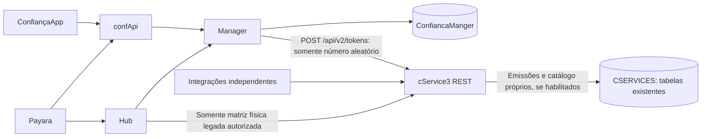

# cService3 e autenticação das aplicações

Revisão de 06/11/2026 para substituir o cServices2.0. Esta versão substitui a etapa intermediária em que o cService3 oferecia somente geração sem persistência. As decisões do usuário sobre autenticação mobile e a proibição de alterar o banco de produção continuam valendo.

| Aplicação | Responsabilidade |
| --- | --- |
| cService3 | Serviço independente de tokens: geração, emissão, validação contextual, consumo único, revogação, expiração, matrizes físicas e cadastros existentes do antigo serviço. REST/JSON/HTTPS, sem SOAP. |
| confApi | Entrada pública do App e regras/encaminhamento das operações de plantão. Não acessa as tabelas de autenticação. |
| Manager | Autenticação, aparelho canônico em dispositivo, sessões, aprovação/troca, contato verificado, histórico e desafios de login/plantão/antifraude. Manipula seu próprio banco. |
| Hub | Integrações do portal; matriz física pelo REST do cService3, autenticação mobile e confirmações de antifraude pelo Manager. Safeguard continua separado. |
| Payara | Contexto da sessão do navegador, apresentação e confirmação do desafio específico. |
| App | Autenticador via confApi, chave/prova do aparelho, sessão pós-MFA e códigos por solicitação. As demais APIs de negócio ainda precisam de adequação ao caminho via confApi. |

O cService3 não chama Manager ou confApi. O Manager usa a geração sem banco do cService; mantém prazo, HMAC, tentativas, consumo e vínculo do aparelho em seu banco. As emissões persistidas do cService são para integrações independentes, não para autenticar o ConfiançaApp.

Os tokens Confiança usam quatro dígitos, conforme a rotina anterior. A geração dinâmica mantém o intervalo de 1000 a 9999 do cServices2.0. As validações e os campos do App e do portal seguem quatro dígitos; o Safeguard mantém seu contrato anterior.

## Bancos e tabelas

**Nenhuma alteração foi executada no banco real. Não recriar AUTH_MOBILE_* no CSERVICES.**

O módulo opcional de persistência do cService reaproveita TOKEN_EMISSAO e o catálogo existente. O schema real foi consultado somente em leitura na revisão anterior. Para o estado observado, o script manual 020_cservices_tokens.sql ajusta as colunas e os índices necessários, sem tabelas mobile.

O Manager reutiliza usuario e dispositivo e agora precisa de cinco tabelas novas: dispositivo_solicitacao, dispositivo_historico, autenticacao_sessao, autenticacao_desafio e autenticacao_controle. Política e contato verificado ficam em usuario; chave aprovada e metadados ficam em dispositivo. Os avisos estão na solicitação, as referências do portal na tabela de sessões e os refreshes no controle compartilhado. Tipos distintos possuem restrições próprias. O novo script manual 011_manager_auth_reduzido.sql substitui a criação das onze AUTH_V2_*; os scripts antigos foram retirados de uso. Ver [explicação de cada tabela e execução manual](REDUCAO_TABELAS_MANAGER_20261106.md).

## Funções do serviço antigo e substituição

| Função anterior | Contrato novo |
| --- | --- |
| Gerar número para outro backend | POST /api/v2/tokens; sem banco e sem garantia de unicidade global. O consumidor controla o ciclo. |
| Emitir token dinâmico e recuperar a mesma emissão após repetição | POST /api/v2/emissoes com Idempotency-Key e subject/purpose/reference; retorno restrito à integração emissora. |
| Gerar posição da matriz física | POST /api/v2/matrizes/desafios; retorna posição e referência, nunca o valor esperado. |
| Validar token/código de segurança | POST /api/v2/emissoes/{id}/validar com o mesmo contexto. Três tentativas, bloqueio, prazo e consumo único transacional. |
| Consultar validade/uso | GET /api/v2/emissoes/{id}; sem recuperar código por login. |
| Inativar/expirar | POST /api/v2/emissoes/{id}/revogar; expiração na validação e job opcional de limpeza do valor cifrado. |
| Empresa, usuário técnico, token/matriz, posições e cartão bloqueado | /api/v2/catalogo; escopos próprios, isolamento por empresa e inativação dos cadastros. Senhas e PAN completo não são retornados. Listagens são limitadas. |
| checarCartao | POST /api/v2/catalogo/cartoes/verificar; consulta a lista de cartões bloqueados, que é distinta da matriz física. |
| Login/senha do integrador e cookie SOAP | Credencial de serviço RS256 com emissor, audiência, prazo curto, escopos e lista de clientes. |

Os antigos contratos SOAP, código em URL, busca global de número, consulta do código por login e senha técnica fixa não são compatíveis nem publicados pelo novo serviço. Os consumidores precisam adotar o contrato REST; não basta trocar a URL. Os números de quatro dígitos podem se repetir entre operações: o contexto é obrigatório. A matriz física usa quatro dígitos, nunca é aceita como código mobile e depende da política de versão mínima do usuário no Manager.

## Alterações nos consumidores

- Hub: cliente REST CService3Client; contexto guardado na sessão do Hub, sem cookie SOAP. A consulta antiga e /api/tokenCservicesOld retornam erro. O estado do cService antigo não é reaproveitado.
- Plantão: Payara guarda challengeId/reference por solicitação; confApi encaminha ao Manager. Não devolve o código esperado ao portal nem aceita celular informado pelo solicitante como destino.
- E-mail: Manager consulta somente o contato verificado nos campos de autenticação de usuario e envia pela integração AUTH_V2_MAIL_URL. Falha de envio invalida o desafio. Não há substituição automática por SMS. É necessário um aparelho ativo também para esse fluxo.
- Antifraude: Hub usa propósito ANTIFRAUDE, vinculado ao ID da operação já autorizada no Manager. O campo histórico cookieCifrado guarda agora contexto JSON cifrado; não guarda cookie SOAP. Payara aceita quatro dígitos e preserva zeros à esquerda.
- App: apresenta finalidade e referência, mantendo DPoP, sessão pós-MFA e confirmação local antes de pedir o código.
- Manager: a antiga validação direta de TOKEN_EMISSAO por login+código foi retirada. /autenticacaoplantao e /api/auth do confApi são contratos encerrados. Consumidores externos, inclusive automações de atendimento que usavam esses contratos, precisam enviar o contexto do novo desafio.

Um código de PLANTAO ou ANTIFRAUDE não pode validar PORTAL_LOGIN nem concluir sua referência primária. O resultado de login exige propósito e provedor de login. Troca de aparelho invalida também os desafios de operação. Safeguard não é selecionado pela quantidade de dígitos e permanece separado.

## Antes de desligar cServices2

1. Preparar uma cópia de homologação dos bancos. Revisar e aplicar os scripts manualmente somente nesse ambiente autorizado. Nenhum script foi aplicado por esta execução.
2. Configurar HTTPS, chaves, identidades e arquivos de credenciais curtas renovados pelo emissor. Ver CONFIGURACAO.md. Nunca colocar segredos de serviço no App.
3. Publicar em homologação Manager, cService3, confApi, Hub, Payara e uma build nativa do App; habilitar as funcionalidades somente após preparar o schema e as integrações.
4. Exercitar login, primeiro aparelho, aprovação, troca, revogação, plantão APP/e-mail, antifraude e matriz física. Conferir tentativas inválidas, expiração, duplicidade e indisponibilidade. A integração de e-mail precisa aceitar o propósito PLANTAO e a chave de idempotência.
5. Identificar outros consumidores independentes do cService antigo e migrar cada contrato. Não há inventário de clientes externos ao workspace. Não existe compatibilidade automática de credenciais, cookies ou emissões antigas; encerrar desafios antigos e iniciar novos na troca.
6. Só descontinuar a instância antiga após os testes e o corte dos consumidores. Esta execução não fez deploy nem desligou serviços.

## Validação e limites

Testes automatizados usam H2 descartável, usuários sintéticos e integrações simuladas; não usam o banco real, não enviam mensagens e não comprovam a configuração de produção. Os pacotes, hashes e resultados finais estão em PACOTES_SERVIDORES_V2.json. O teste integrado por HTTPS, a entrega real e a build/teste em aparelho continuam dependentes do ambiente de homologação.

A autorização das rotas de negócio do App ainda depende da allowlist de recursos e origens já prevista. Não preencher essa lista com todas as rotas indiscriminadamente. Não foi feita uma auditoria completa das demais funcionalidades dos projetos.

Backups e logs desta etapa: D:\Projetos\cServices3.0\.local\replacement. O projeto antigo não foi alterado.

## Revisão posterior

A revisão de 06/11/2026 corrigiu sessão, plantão, validação de identidade técnica e matriz. Foram identificadas pendências nas APIs de negócio do App, filtros/uploads e automações antigas. Ver [relatório de revisão](REVISAO_INTEGRACAO_20261106.md) antes de considerar a descontinuação do serviço antigo.

## Metadados do dispositivo

A tabela dispositivo mantém data de inclusão, data de vínculo, IP observado, identificação da chave e dados descritivos. As dez colunas já existem no banco conferido; não reaplicar o antigo 004. candidate_metadata pertence agora a dispositivo_solicitacao. Ver [estrutura atual](REDUCAO_TABELAS_MANAGER_20261106.md).

## Conferencia direta dos bancos

A consulta anterior foi somente leitura. O usuário confirmou que não criou as onze AUTH_V2_* no Manager. A implementação foi reduzida para cinco tabelas, em minúsculas, e o script indicado agora é 011_manager_auth_reduzido.sql. As dez colunas de metadados em dispositivo já existem. Nenhuma escrita foi executada nos bancos.
