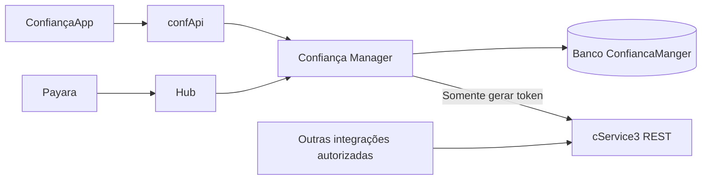

> Registro histórico de uma etapa anterior. A estrutura atual usa cinco tabelas novas no Manager e reutiliza usuario/dispositivo. Não aplicar as instruções antigas de banco deste documento. Consulte [a redução atual](REDUCAO_TABELAS_MANAGER_20261106.md) e o script manual 011_manager_auth_reduzido.sql.

# cService independente e autenticação no Manager

Decisão do usuário em 05/11/2026. Esta orientação substitui a distribuição de responsabilidades do plano inicial e os documentos anteriores deste projeto.

## Responsabilidades implementadas

| Aplicação | Responsabilidade |
| --- | --- |
| cService3 | Gerar tokens numéricos para integrações autorizadas. REST/JSON e HTTPS. Sem autenticação de pessoas, aparelhos, sessões, e-mail ou banco. |
| confApi | Entrada pública do ConfiançaApp; validação das rotas e cabeçalhos permitidos, preservação da prova do aparelho e encaminhamento autenticado ao Manager. |
| Manager | Controle transacional de autenticação, prova da chave, sessões, renovação, tentativas, códigos, aprovações, dispositivo, contato e histórico. Acesso ao banco. |
| Hub e Payara | Início e validação do desafio do portal no Manager. A sessão do navegador continua no Payara. |

O cService não chama confApi ou Manager e pode ser executado independentemente. Seu único vínculo com o autenticador é fornecer o número aleatório; o Manager decide prazo, destinatário, tentativas, aprovação, consumo único e revogação. Falha de geração bloqueia a emissão, sem geração local de outro código.

## Contrato do cService3

POST /api/v2/tokens, com JSON e Authorization Bearer de serviço. Entrada: purpose e reference, uma referência opaca de 16 a 128 caracteres. Resposta: issuanceId, token, clientId, purpose, reference e issuedAt. O token é texto de quatro dígitos, preservando zeros à esquerda. A resposta usa Cache-Control: no-store.

O clientId deriva da credencial técnica validada. O serviço verifica assinatura RS256, emissor, audiência cservice3-tokens, token_use SERVICE, validade de até cinco minutos, escopo token:generate e lista de consumidores permitidos. Essas são proteções da API de geração, sem login do aplicativo.

Não há validação de código, consulta por usuário ou armazenamento de emissão no cService. Cada repetição gera nova emissão. O consumidor controla idempotência, prazo e consumo. Os quatro dígitos não têm unicidade global: a validação deve considerar o contexto da operação.

SOAP, /api/token/**, /api/v2/autenticador-mobile/** e /internal/v2/login/** não são publicados pelo cService3. O cServices2.0 não foi alterado; consumidores antigos precisam adotar o contrato novo antes de substituí-lo.

## Armazenamento

**Não recriar as tabelas AUTH_MOBILE_* excluídas do CSERVICES.** O cService3 não contém JDBC, driver MySQL, Flyway, migrações ou verificação dessas tabelas. O perfil local não importa a antiga configuração privada de datasource.

O módulo mobile do Manager usa authV2Jdbc e authV2TransactionManager, ligados ao ConfMangerDataSource:

| Controle anterior | Destino no Manager |
| --- | --- |
| CREDENCIAL e CADASTRO | AUTH_V2_ENROLLMENT: chave pública, idempotência, código protegido e entrega, na própria solicitação de aprovação. |
| ATIVO | AUTH_V2_ACCOUNT e dispositivo. O bloqueio da conta coordena a ativação; não existe segundo ponteiro ativo no cService. |
| EVENTO | AUTH_V2_HISTORY: eventos técnicos e histórico do aparelho, identificados por tipo e correlação. |
| Sessões | Nova AUTH_V2_MOBILE_SESSAO. |
| Renovações e detecção de reutilização | Nova AUTH_V2_MOBILE_REFRESH. |
| Tentativas de login do portal | Nova AUTH_V2_MOBILE_DESAFIO. |
| Limites e provas já utilizadas | Nova AUTH_V2_MOBILE_CONTROLE. |

São quatro tabelas adicionais no Manager, reaproveitando as sete AUTH_V2_* previstas anteriormente. dispositivo e usuario continuam como cadastros existentes. A solicitação não altera o aparelho atual: a gravação só acontece na ativação aprovada. A mudança de aparelho, seu histórico e a revogação das sessões mobile anteriores agora compartilham a mesma transação.

O arquivo do Manager src/main/resources/db/auth-v2/003_mobile_no_manager.sql depende de 001 e 002. **Não é executado automaticamente e não foi aplicado em banco real.** Os scripts 001 e 002 foram preservados. Antes de habilitar o módulo, conferir a estrutura e preparar um ambiente autorizado. Não executar as migrações históricas do cService para este desenho.

## Configuração

| Projeto | Configuração |
| --- | --- |
| cService3 | CSERVICE_TOKENS_ENABLED (false por padrão), CSERVICE_TOKEN_ISSUER, CSERVICE_TOKEN_PUBLIC_JWKS (somente chaves públicas) e CSERVICE_TOKEN_CLIENTS (lista separada por vírgula). |
| Manager | AUTH_MOBILE_ENABLED (false por padrão), AUTH_V2_ENABLED, AUTH_MOBILE_PUBLIC_BASE_URL (URL pública completa do confApi), AUTH_MOBILE_HMAC_KEY_BASE64, AUTH_MOBILE_HMAC_KEY_ID e AUTH_MOBILE_DELIVERY_AES_KEY_BASE64. Chaves HMAC e AES distintas; AES de 32 bytes. |
| Manager → cService | CSERVICE_TOKEN_URL e CSERVICE_TOKEN_CLIENT_FILE. Credencial sub=manager, aud=cservice3-tokens, scope=token:generate, token_use=SERVICE. |
| confApi → Manager | AUTH_V2_MANAGER_URL e AUTH_V2_MANAGER_TOKEN_FILE. Identidade sub=confapi, aud=manager-v2, scopes v2:access, mobile:relay e session:introspect, além dos escopos necessários às outras operações. |
| Hub → Manager | AUTH_V2_MANAGER_URL e AUTH_V2_MANAGER_TOKEN_FILE para introspecção. Desafios preservam a identidade do Payara, aud=manager-v2, com v2:access e portal:create/portal:validate. |
| Payara | AUTH_V2_PRIMARY_URL e AUTH_V2_PORTAL_URL continuam apontando às entradas configuradas de confApi/Hub; usar AUTH_V2_MANAGER_TOKEN_FILE. Provedor novo: MANAGER_V2. |
| App | EXPO_PUBLIC_CONFAPI_AUTH_V2_URL permanece a URL pública do confApi. Nenhuma credencial técnica vai para o app. |

Manager, confApi e Hub continuam usando AUTH_V2_ISSUER e AUTH_V2_JWKS_JSON. X-Auth-Gateway é produzido pelo confApi e não substitui Authorization DPoP ou a prova do aparelho. A audiência antiga cservice3-internal é rejeitada no Manager.

AUTH_V2_CSERVICE_URL e AUTH_V2_CSERVICE_TOKEN_FILE deixaram de ser usados para sessões e desafios. A geração usa CSERVICE_TOKEN_URL e CSERVICE_TOKEN_CLIENT_FILE, exclusivamente no Manager. AUTH_RESOURCE_ORIGINS_JSON continua necessário à introspecção das rotas de negócio.

A entrega de confirmação requer AUTH_MOBILE_DELIVERY_ENABLED=true e o serviço de e-mail já configurado no Manager. Configurações privadas, chaves e tokens não foram alterados nem provisionados nesta etapa. Não habilitar o módulo contra produção antes de preparar seu schema e validar as integrações.

## Validação e limites

Testes com H2 descartável, usuários sintéticos, MockMvc e geração de tokens simulada no Manager. Cobrem aprovação, vínculo canônico, revogação, rollback, repetição de provas, renovação, confirmação, tentativas, expiração, concorrência e identidade do confApi. O cService é testado sem datasource e sem outros serviços.

Não houve acesso ao banco real, recriação de tabelas, deploy, reinício dos serviços do usuário ou envio de mensagens. Integração real por HTTPS, entrega de e-mail e teste do app em aparelho físico continuam pendentes. O código do app não precisou mudar: entrada pública e DTOs foram preservados.

Logs e cópia dos fontes anteriores: D:\Projetos\cServices3.0\.local\token-only, fora do pacote executável. Os relatórios e instruções anteriores sobre tabelas no CSERVICES são históricos.
