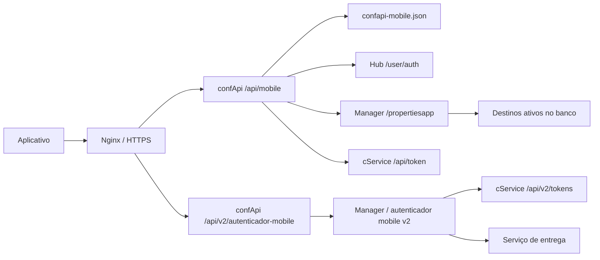

# Diagnóstico de configuração: confApi4, Manager, Hub e cService3

Data: 10/11/2026. Análise do relatório de infraestrutura, dos fontes locais e das configurações incluídas nos pacotes locais.

Este documento registra o diagnóstico inicial. Os ajustes e testes realizados depois, a pedido do usuário para incorporar a configuração nos pacotes, estão em [Entrega v4](D:/ConfApi/docs/ENTREGA_V4_20261110.md).

## Conclusão

O 503 `MOBILE_INDISPONIVEL` é compatível com ausência do JSON privado ou com `enabled=false`. A causa descrita no relatório está confirmada no código e foi reproduzida localmente. Porém, o JSON sugerido no relatório está incompleto: falta `services.manager`. Apenas criar aquele arquivo e acrescentar um cabeçalho no Nginx não conclui a configuração do fluxo.

Manager, Hub e cService3 também têm funcionalidades condicionadas a parâmetros externos, arquivos de credenciais e HTTPS. Há dois contratos mobile independentes no confApi: `/api/mobile` e `/api/v2/autenticador-mobile`. Habilitar um não configura o outro.

Não houve conexão com os servidores OCI, leitura da configuração efetiva do Tomcat/systemd, consulta a banco real, envio de mensagens, deploy ou alteração de configuração operacional. As condições do servidor descritas no PDF são evidência fornecida pela infraestrutura; não foram medidas novamente nesta análise.

## Projetos e pacotes efetivamente analisados

| Componente | Fonte local | Pacote local |
|---|---|---|
| confApi | `D:/ConfApi` | `D:/ConfApi/target/confApi4.war` |
| Manager atual | `D:/confiancaManager1` | `D:/confiancaManager1/target/confiancamanger4.war` |
| Hub | `D:/hubconfianca` | `D:/hubconfianca/target/SandBox4.war` |
| cService3 | `D:/Projetos/cServices3.0` | `D:/Projetos/cServices3.0/target/codtk2.jar` |

Existem outras cópias de Manager e CService no disco. Os diretórios acima correspondem aos pacotes v4 atuais encontrados. O nome `codtk2.jar` é o nome do pacote local encontrado para o projeto cService3; não prova qual processo atende cada domínio público.

Todos os 15 arquivos `application*` presentes nesses quatro pacotes coincidem com os respectivos fontes, desconsiderando apenas finais de linha. Isso verifica as configurações embarcadas locais, não a igualdade com os binários implantados em OCI nem os valores externos que os sobrescrevem.

## Mapa das dependências



### 1. confApi: gateway `/api/mobile`

**Confirmado:** [MobileSettings.java](D:/ConfApi/src/main/java/com/confApi/mobile/MobileSettings.java:19) procura o arquivo nesta ordem: propriedade JVM `confianca.mobile.config`, variável `CONFIANCA_MOBILE_CONFIG`, caminho `${user.home}/.confianca/confapi-mobile.json`. Uma propriedade JVM definida prevalece sobre a variável. O arquivo é lido na criação do componente; sua alteração exige reinício/redeploy da aplicação.

- Arquivo ausente ou `enabled=false`: 503 `MOBILE_INDISPONIVEL`.
- Arquivo JSON ilegível/inválido: pode impedir a inicialização do componente; não é o mesmo caso de arquivo ausente.
- Módulo habilitado, mas `request.isSecure()` falso em produção: 400 com o mesmo código `MOBILE_INDISPONIVEL`.
- `services.manager` ausente: 503 `DESTINO_INDISPONIVEL` ao buscar a configuração pública.
- Credencial técnica ausente: 503 `CONFIGURACAO_INDISPONIVEL` quando utilizada.

O método [properties()](D:/ConfApi/src/main/java/com/confApi/mobile/MobileUpstream.java:47) precisa de **Hub e Manager**: autentica a conta técnica no Hub e lê `propertiesapp` no Manager. O JSON do PDF contém apenas Hub. A ausência de Manager foi reproduzida sem conexão de rede.

Exemplo estrutural corrigido para o bootstrap, ainda dependente de credenciais e de validação das rotas HTTPS no proxy:

```json
{
  "enabled": true,
  "development": false,
  "technicalLogin": "<conta-tecnica-autorizada>",
  "technicalPassword": "<segredo-provisionado-no-servidor>",
  "services": {
    "hub": "https://intranet.confianca.tur.br/SandBox4/",
    "manager": "https://intranet.confianca.tur.br/confiancamanger4/"
  },
  "allowedProductionHosts": [
    "intranet.confianca.tur.br"
  ]
}
```

O contexto HTTPS do Manager acima é uma proposta baseada no contexto configurado nos fontes; sua publicação no Nginx precisa ser confirmada. Os placeholders não são credenciais utilizáveis. A lista de hosts deve incluir somente as autoridades efetivamente aprovadas para os destinos ativos, com porta quando aplicável.

**Ajuste adicional necessário no cadastro de destinos:** em produção, o JSON fornece os endereços iniciais; os destinos de negócio vêm de `propertiesapp`. Preencher `services.confapi`, `services.cache` etc. não substitui esse cadastro em produção.

| Destino | Nome no cadastro, também aceitando prefixo `app` |
|---|---|
| Manager | `baseUrl` |
| Hub | `baseUrlHub` |
| confApi | `urlApi` |
| Cache | `urlCache` |
| cService | `urlCservice` |
| Base de e-mail | `urlEmailBase` |
| Envio de e-mail | `urlEmail` |
| Orçamento | `urlOrcamentoClienteBase` |

As linhas precisam estar ativas (`status=1`), com HTTPS e host permitido nos fluxos que verificam destinos. Um destino reconhecido, ativo e inválido pode interromper a resolução do conjunto. HTTP interno, host fora da lista ou destino ausente produzem novos bloqueios. Não foi consultado o conteúdo real dessa tabela.

Para gerar tokens pela rota legada do gateway, são necessários também `cserviceLogin` e `cservicePassword`; `cserviceTokenResponseKey` é necessário quando a resposta vem cifrada. Essas chaves não são pré-requisitos para apenas consultar `/config`, mas faltam no exemplo do PDF para o fluxo completo. Evidências: [MobileApi.java](D:/ConfApi/src/main/java/com/confApi/mobile/MobileApi.java:73) e [MobileTokenResponse.java](D:/ConfApi/src/main/java/com/confApi/mobile/MobileTokenResponse.java:23).

### 2. HTTPS: Nginx e aplicação precisam concordar

**Confirmado no código e reproduzido:** o filtro usa `request.isSecure()`. Um cabeçalho `X-Forwarded-Proto: https`, sem nenhum componente que o interprete, não muda esse resultado.

Não foi encontrado tratamento explícito de forwarded headers nos fontes/configurações examinados de confApi, Hub e Manager. Isso não exclui um `RemoteIpValve` já configurado externamente no Tomcat.

Para os WARs no Tomcat 9 externo, verificar o conector/`RemoteIpValve` e a confiança no endereço real do proxy. O Nginx deve fornecer o protocolo observado e o Tomcat deve interpretá-lo. O processamento deve aceitar informação apenas da cadeia de proxies confiáveis. Outra opção é HTTPS também até o backend, conforme a topologia adotada.

Referência: [Tomcat 9: Remote IP Valve](https://tomcat.apache.org/tomcat-9.0-doc/config/valve.html#Remote_IP_Valve). Para execução com servidor embarcado, há também as estratégias do [Spring Boot 2.7.9](https://docs.spring.io/spring-boot/docs/2.7.9/reference/html/howto.html#howto.webserver.use-behind-a-proxy-server).

No cService3, [application.yml](D:/Projetos/cServices3.0/src/main/resources/application.yml:3) declara expressamente `server.forward-headers-strategy: none`. Com TLS terminado antes dele e HTTP até o serviço, a API v2 recusa a chamada com `HTTPS_OBRIGATORIO`, salvo configuração adicional apropriada. Apenas enviar o cabeçalho não resolve.

### 3. Manager: configuração v2 e URL adicional incorreta para a topologia descrita

**Dependências confirmadas; ausência no servidor ainda não verificada:**

| Finalidade | Configurações |
|---|---|
| Ativação | `AUTH_V2_ENABLED`, `AUTH_MOBILE_ENABLED` |
| Identidade técnica | `AUTH_V2_ISSUER`, `AUTH_V2_JWKS_JSON` |
| Autenticador mobile | `AUTH_MOBILE_PUBLIC_BASE_URL`, `AUTH_MOBILE_HMAC_KEY_BASE64`, `AUTH_MOBILE_HMAC_KEY_ID`, `AUTH_MOBILE_DELIVERY_AES_KEY_BASE64` |
| Entrega de códigos | `AUTH_MOBILE_DELIVERY_ENABLED`, `AUTH_V2_MAIL_URL`, `AUTH_V2_MAIL_TOKEN_FILE` |
| Geração no cService3 | `CSERVICE_TOKEN_URL`, `CSERVICE_TOKEN_CLIENT_FILE` |
| Operadores/suporte | `AUTH_V2_OPERATOR_PRIVATE_JWK_FILE` |
| Recursos e operações | `AUTH_RESOURCE_ORIGINS_JSON`, `AUTH_V2_OPERATION_CLIENTS_JSON` |

Sem `auth.mobile.enabled=true`, os componentes de autenticação mobile do Manager não são registrados. Com o piloto v2 desabilitado, os fluxos correspondentes retornam 503. Banco/schema ausente é outra causa de indisponibilidade; não deve ser confundido com falta do arquivo JSON do confApi.

Evidências: [MobileConfiguration.java](D:/confiancaManager1/src/main/java/com/confianca/mobileauth/MobileConfiguration.java:3), [V2Security.java](D:/confiancaManager1/src/main/java/com/confianca/authv2/V2Security.java:25), [Sessions.java](D:/confiancaManager1/src/main/java/com/confianca/mobileauth/Sessions.java:51).

**Achado concreto de configuração embarcada:** [application.properties](D:/confiancaManager1/src/main/resources/application.properties:11) habilita o módulo administrativo de IA e usa `chat-ia.admin.conf-api-url=http://localhost:8088`. Não há substituição dessa propriedade em `application-prod.properties`. O cliente acrescenta `/v1/chat-confianca/admin/ia/catalogo`.

Na topologia do relatório, confApi4 é um WAR com contexto `/confApi4` no Tomcat. Sem override externo ou outra instância efetivamente atendendo em `localhost:8088`, o catálogo administrativo falha com 503. Configurar a base real, incluindo o contexto; por exemplo, `CHAT_IA_ADMIN_CONF_API_URL=https://intranet.confianca.tur.br/confApi4`, após confirmar essa rota. Isso é independente do problema mobile.

### 4. Hub / SandBox4

O 403 na raiz `/SandBox4/` é coerente com [SecurityConfig.java](D:/hubconfianca/src/main/java/conf/autenticacao/app/config/SecurityConfig.java:69): a raiz exige autenticação; `POST /user/auth/**` é liberado pela cadeia. Esse 403 sozinho não demonstra falha de implantação, mas também não comprova que login, banco e integrações estejam funcionando. O sucesso de `/user/auth` em OCI foi informado no PDF, não repetido nesta análise.

As rotas v2 dependem de `AUTH_V2_ENABLED`, emissor/JWKS e HTTPS. Para consultar o Manager, dependem de `AUTH_V2_MANAGER_URL` e `AUTH_V2_MANAGER_TOKEN_FILE`. Para sessão mobile de recursos, precisam também de `AUTH_V2_RESOURCE_ORIGIN` e `AUTH_V2_MOBILE_ROUTES_JSON`; a lista vazia bloqueia o acesso a esses recursos.

Para matriz física no contrato cService3, o Hub usa `CSERVICE_TOKEN_URL` e `CSERVICE_TOKEN_CLIENT_FILE`, além das políticas e da persistência necessárias no cService. O arquivo de exemplo do Hub não contém todas essas variáveis específicas.

**Risco que também alcança endpoints existentes:** a validação de JWT individual `USUARIO_MANAGER` consulta o Manager mesmo com `AUTH_V2_ENABLED=false`. URL ou arquivo de credencial ausente impede validar o usuário; desligar a flag não elimina essa dependência. Tokens técnicos antigos não percorrem esse mesmo ramo. Evidências: [JwtService do Hub](D:/hubconfianca/src/main/java/conf/autenticacao/app/security/jwt/JwtService.java:63) e [JwtService do confApi](D:/ConfApi/src/main/java/com/confApi/security/jwt/JwtService.java:59).

### 5. cService3: sim, há risco equivalente de configuração incompleta

O cService3 tem três conjuntos de pré-requisitos distintos:

| Fluxo | O que precisa estar configurado | Comportamento sem configuração |
|---|---|---|
| SOAP/REST legado (`/services`, `/cServices`, `/api/token`) | `CSERVICE_LEGACY_ENABLED`, banco `CSERVICE_DB_URL/USER/PASSWORD`, `CSERVICE_LEGACY_HASH_SECRET` e URLs necessárias de Manager/e-mail | Sem URL do banco e com storage desabilitado, o módulo legado não é registrado. Outras ausências podem causar falhas de inicialização ou de operação. |
| Geração v2 (`/api/v2/tokens`) | `CSERVICE_TOKENS_ENABLED=true`, `CSERVICE_TOKEN_ISSUER`, `CSERVICE_TOKEN_PUBLIC_JWKS`, `CSERVICE_TOKEN_CLIENTS`, JWT válido e HTTPS reconhecido | Geração desabilitada: 503 `GERACAO_DESABILITADA` após a validação de HTTPS. Identidade inválida: 401; cliente/escopo não autorizado: 403. |
| Emissões, matriz e catálogo v2 | Configuração anterior + `CSERVICE_STORAGE_ENABLED=true`, banco preparado, `CSERVICE_STORAGE_KEYS_JSON`, `CSERVICE_CLIENT_POLICIES_JSON` | Persistência não habilitada: 503 `PERSISTENCIA_NAO_HABILITADA` nas operações correspondentes; chaveiro inválido pode impedir inicialização. |

A geração simples `/api/v2/tokens` não exige habilitar persistência. Também não é necessário ligar `CSERVICE_STORAGE_ENABLED` apenas para registrar a compatibilidade legada, desde que sua URL de banco esteja configurada.

Evidências: [LegacyDatabaseCondition.java](D:/Projetos/cServices3.0/src/main/java/br/com/confianca/cservice3/LegacyDatabaseCondition.java:9), [SecurityConfig.java](D:/Projetos/cServices3.0/src/main/java/br/com/confianca/cservice3/SecurityConfig.java:20), [IssuanceApi.java](D:/Projetos/cServices3.0/src/main/java/br/com/confianca/cservice3/IssuanceApi.java:15).

**Carregamento do arquivo:** o perfil `local` importa obrigatoriamente `${user.home}/.confianca/cservice-local.properties`, ou o caminho indicado por `CSERVICE_LOCAL_CONFIG`. O perfil `prod` não importa esse arquivo automaticamente. Em produção, é necessário fornecer variáveis ou configurar `spring.config.additional-location` com um caminho real do servidor. Uma configuração de execução do IntelliJ que aponta para um arquivo Windows não provisiona o arquivo no Linux.

Ativar `prod` fornece os padrões de Manager e e-mail, mas não fornece senha do banco, segredo de hash, JWT/JWKS nem ativa a API v2. Sem perfil `prod` e sem as variáveis correspondentes, as URLs padrão de Manager/e-mail no arquivo base ficam vazias.

**Endereços divergentes a conferir:** o confApi embarca `cservices-url=https://codtk2.confianca.tur.br/`; o Hub embarca `cservice-app=https://cservices2.confianca.tur.br/`. O gateway mobile ainda obtém `urlCservice` do Manager; os clientes v2 usam `CSERVICE_TOKEN_URL`. São seletores diferentes. Não foi verificado se os domínios são aliases para a mesma instância. Atualizar apenas um deles não garante que todos os fluxos passem a usar cService3.

## Cuidados com o mecanismo de configuração

1. **`application.properties`, JSON e ambiente não são intercambiáveis.** `V2.setting()` usa diretamente `System.getProperty(nome)` e `System.getenv(nome)` em confApi, Hub e Manager. Inserir `AUTH_V2_MANAGER_URL=...` em um arquivo Spring externo não o torna visível para esse leitor. É necessário exportar a variável para o processo ou usar `-D` com o nome exato. O cService3 usa o ambiente de configuração do Spring para seus parâmetros.
2. **Arquivos `.env.example` não são carregados automaticamente.** É preciso configurar o lançador/systemd/container. O verificador PowerShell existente examina somente o ambiente do seu próprio processo, não a JVM do servidor; um resultado local não certifica OCI.
3. **JWT técnico em arquivo precisa de renovação.** O arquivo contém o JWT puro, sem `Bearer `. A validação exige prazo de no máximo 300 segundos. Arquivo existente com token expirado continua inválido. A variável aponta para um arquivo, não para o próprio token. Conferir emissor, audiência, cliente e escopos de cada integração.
4. **Se os WARs compartilham uma JVM, as variáveis e `-D` também são compartilhados.** confApi e Hub usam o mesmo nome `AUTH_V2_MANAGER_TOKEN_FILE`, mas a identidade mobile do confApi é `confapi` e as políticas de operação distinguem os serviços. Manager e Hub também usam `CSERVICE_TOKEN_CLIENT_FILE`. Valores globais não permitem configurar arquivos diferentes por WAR. Confirmar a topologia; caso precise dessas identidades distintas na mesma JVM, será necessário isolamento de processos ou ajuste no código para configuração por aplicação.
5. **Documentação antiga contém orientações incompatíveis com o código atual.** O cabeçalho de `D:/ConfApi/config/auth-v2.env.example` ainda menciona `AUTH_V2_CSERVICE_TOKEN_FILE` e audiência `cservice3-internal`, mas o relay mobile atual usa `AUTH_V2_MANAGER_TOKEN_FILE` e encaminha ao Manager. O exemplo do Manager também não cobre `AUTH_RESOURCE_ORIGINS_JSON` e `AUTH_V2_OPERATION_CLIENTS_JSON`. Não utilizar esses exemplos como inventário completo de produção.
6. **HTTP interno dos clientes antigos não pode ser simplesmente copiado para os novos parâmetros.** As bases tradicionais `confianca-manager`, `confianca-hub` e `url.sandBox` incluem HTTP interno e podem ser válidas para seus contratos existentes. O gateway mobile em produção e os clientes v2 exigem HTTPS; são leitores e contratos diferentes.

## Sequência proposta para correção e validação no servidor

1. Confirmar os pacotes implantados, os contextos exatos, o usuário de execução, `user.home`, as JVMs compartilhadas e o perfil ativo de cada serviço. Comparar os pacotes com os locais antes de aplicar conclusões sobre o código.
2. Provisionar `confapi-mobile.json` legível pelo usuário do serviço, com Hub, Manager e conta técnica. Manter `development=false`. Escolher explicitamente o caminho por propriedade JVM ou variável e reiniciar/reimplantar o confApi após a alteração.
3. Conferir Nginx + Tomcat para que o backend reconheça HTTPS. Repetir `GET /confApi4/api/mobile/config`: 503 `MOBILE_INDISPONIVEL` indica que a ativação ainda falhou; 400 com o mesmo código indica a verificação de HTTPS; outro código deve ser rastreado até a dependência correspondente.
4. Verificar a conta técnica em `POST /SandBox4/user/auth` e o acesso a `/confiancamanger4/propertiesapp`. Conferir cadastro de destinos, aliases, flags e hosts autorizados. O JSON de `/config` pode funcionar antes de todos os destinos de negócio estarem corretos; validar os fluxos efetivamente consumidos pelo aplicativo.
5. Conferir o cService3 separadamente nos contratos legados e v2, com o perfil correto e o arquivo/ambiente do processo. `GET /actuator/health` isoladamente não certifica habilitação de tokens nem presença dos endpoints legados.
6. Configurar o fluxo v2 somente conforme o contrato utilizado: Manager, chaves, arquivos de JWT renováveis, políticas, rotas e serviço de entrega. Não usar `AUTH_V2_ENABLED=true` como correção genérica para o 503 de `/api/mobile`; são controles distintos e a flag também altera cadeias de autenticação de outras rotas.
7. Corrigir a URL do catálogo administrativo de IA no Manager para o endereço/contexto real do confApi4 e conferir as permissões da chamada.
8. Homologar login, dispositivo, token, consulta de negócio e comunicação entre componentes no ambiente novo, antes de mudar os consumidores que ainda usam os contextos anteriores.

## Verificação realizada nesta análise

- Leitura integral e inspeção visual das duas páginas do relatório fornecido.
- Inspeção dos fontes e configurações dos quatro componentes, incluindo os arquivos embarcados em seus WAR/JAR locais.
- 27 testes existentes do confApi executados e aprovados, sem falhas, erros ou testes ignorados: `MobileUpstreamTest` (12), `MobileTokenResponseTest` (5), `MobileAuthenticatorRelayTest` (7), `JwtRevocationTest` (3).
- Cinco verificações adicionais isoladas aprovadas: arquivo ausente desabilita mobile; JSON sem Manager gera 503; cabeçalho forwarded isolado mantém 400; requisição marcada como segura passa no filtro habilitado; filtro desabilitado retorna 503 mesmo com HTTPS.
- Execução sem banco real e sem chamadas HTTP externas pelos testes/probe. O endpoint do probe é simulado: seu 200 comprova somente a passagem pelo filtro, não o funcionamento das dependências.
- Maven executado offline. Foi necessário um arquivo temporário de settings para reconhecer o identificador do repositório já presente no cache; nenhuma configuração global do Maven foi alterada.
- Evidências temporárias em `D:/ConfApi/tmp/config-audit/`: `confapi-tests.log`, `mobile-probe.log`, `MobileConfigProbe.java` e `artifact-config-comparison.json`.

Os testes de Hub, Manager e cService3 não foram executados nesta análise; nesses componentes, as conclusões são da leitura dos fontes e configurações. Os resultados locais não substituem a validação integrada em OCI. Nenhum fonte de aplicação, configuração operacional ou pacote de implantação foi alterado por esta análise.
